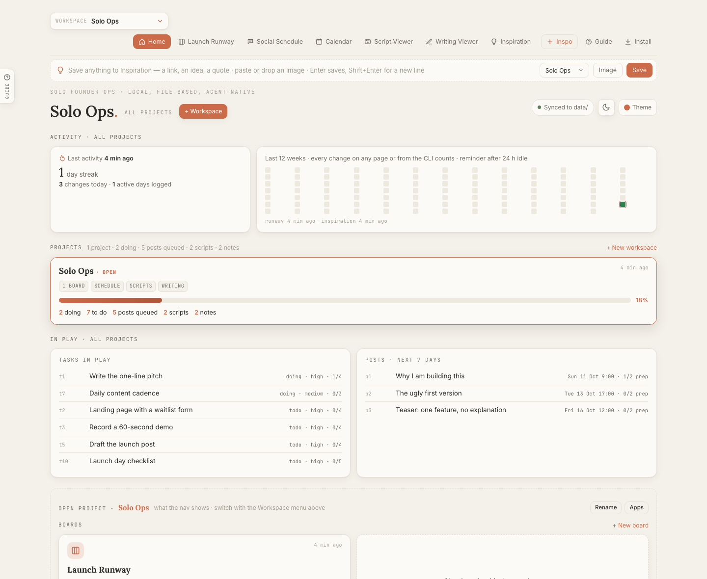

<p align="center"></p>

<h1 align="center">Solo Ops</h1>
<p align="center"><b>Solo founder ops, in plain files.</b><br>
Boards · posting schedule · video scripts · drafts · inspiration inbox — local, installable, and native to your AI.</p>

---

Solo Ops is for people shipping things alone: the indie hacker juggling a
launch, a side project and "business as usual"; the creator with a posting
calendar and a pile of half-written scripts. It gives you the five tools you
actually use, keeps everything in **JSON files on your machine**, and makes
those files the thing your **AI agent** reads and updates — so you stop
re-typing your to-do list into ChatGPT.

<p align="center"></p>

```
$ node solo.js week
# Next 7 days · Oct 10 → Oct 17
Last activity 2 h ago · streak 6 days
**Launch:** 4/11 done (36%)   **Business as usual:** 2/5 done
## Doing (2)
- [t3] Record a 60-second demo · content · high · 1/4 steps
…
```
…and the board in your browser updates by itself.

<table><tr>
<td></td>
<td></td>
</tr><tr>
<td></td>
<td></td>
</tr><tr>
<td></td>
<td></td>
</tr></table>

## Why it exists

Static files are enough now. A folder of JSON and HTML is a complete tool:
no account, no server bill, nothing to sync, nothing that disappears when a
company pivots. And most of us already have several agents working for us;
managing them is the hard part, and paying for another service to do the
managing feels redundant. So the boards, the schedule and the inbox are the
shared memory you and your agents read and write. **They run the loop, you
steer.** The longer version, and what is coming next, is in
[`about.html`](about.html) (also linked from Home and the Guide).

## Why it is different

| | Solo Ops |
|---|---|
| **Where your data lives** | `data/*.json` in a folder you own. No account, no server, no sync service. |
| **How your AI uses it** | It reads the same files. Paste `AGENTS.md` into Claude, ChatGPT or Claude Code and it knows the schema and the CLI. Every agent change is logged and revertable. |
| **How you use it without clicking** | `node solo.js today / week / add / done / social next / inspo add …` |
| **How non-technical people use it** | Download, double-click `index.html`. Or `node serve.js` and click **Install** to get it as an app. |
| **How many projects** | As many **workspaces** as you like, each with its own boards, schedule, scripts and notes — and a Home that shows all of them at once. |

## The apps

| | What it does |
|---|---|
| **Home** | Helicopter view: activity streak + heatmap, idle reminder with a suggested next step, every project with its stats, tasks and posts in play across all projects, inspiration inbox, recent changes with revert. |
| **Boards** | Kanban: To Do / Doing / Done, a Later parking lot, a Bucket List for ideas. Checklists, priority, project chips, tags, notes, drag & drop. One file per board; create boards blank, from the sample sprint, or as a copy. |
| **Social Schedule** | A posting arc: date, copy, type, prep checklist, images, video status; mark posted and log engagement. Calendar with a 52-week streak heatmap. |
| **Script Viewer** | Reels/shorts scripts: hook, numbered beats, inserts, prep. Reader view, 9:16 preview, teleprompter. A library of scripts. |
| **Writing Viewer** | Drafts with `~~cuts~~`, `++adds++` and `[[notes for the AI]]`. Copy for AI, copy clean, change log view, images. |
| **Inspiration** | An inbox for anything worth keeping. A **capture strip sits under the nav on every page**: type or paste anything and press Enter; drag a link, text or image from anywhere toward the page and drop it; paste with nothing focused. Images save the moment they arrive, details are optional. Every item gets basic information for free: a kind tag, the site as a tag for links, and (with the server running) the page's real title and description. Each save shows a toast with Undo. **Assess new inspiration** hands your agent only what you saved since last time. Tag with a workspace, then **Use as** task / post / script / draft, or **Brainstorm with AI** (copies the items plus instructions for your chat). |
| **Guide** | The tab on the left edge of every screen (or the `?` key). Pick how your agent works once: **runs commands** (Claude Code, Cursor, Claude Desktop with the folder) or **chat only** (ChatGPT, Claude.ai). Then use the prompts, grouped by routine: daily standup, what should I do now, wrap up the day, weekly review, retro and plan, plan a project from scratch, add tasks from a list, break a task into steps, clean up the board, draft next week's posts, write a script, edit a draft, turn inspiration into work, brainstorm post ideas, undo. Prompts with blanks ask you first. In chat mode every prompt carries a snapshot of your data, and **Apply a reply** previews the agent's answer (command lines or a checklist) as a tick list and applies what you keep — no terminal. **Edit any prompt or add your own** (✎ and + in the Guide, or `node solo.js prompts`); they live in `data/prompts.json`. **Copy context** hands your agent exactly the thing you mean: recent changes with each item's state, the last task you touched, the item open on this page, the whole project, everything in Doing, upcoming posts, or the inspiration inbox — and each is a `{{token}}` you can drop into your own prompts. |

Every page has a **⌘K command palette** with the same verbs as the CLI, a
**theme picker** (auto/light/dark × five palettes) and a **sync pill** that
tells you where your data is.

## Install

**Just open it.** Download or clone, double-click `index.html`. Everything
works from `file://`. In Chrome/Edge, click **Link folder** once and the pages
write `data/*.json` directly; elsewhere use **File → Save / Load**.

**As an app (recommended).**

```bash
git clone https://github.com/anshulixyz/solo-ops && cd solo-ops
node serve.js          # http://localhost:4321
```

Open it, click **Install** in the nav. Chrome and Edge put it in your
Applications folder (under "Chrome Apps" on macOS) and it opens in its own
window with a Dock icon; Safari 17+ uses File → Add to Dock. Zero
dependencies; Node is only for the server and the CLI.

**Always fresh, works offline.** Code and pages are fetched network-first, so
a running server always serves the latest files; the service worker keeps a
copy only as the offline fallback. `data/*.json` and the API are never
cached. `serve.js` stamps the worker with a hash of every file's modification
time, so each code change is a new version: open pages get a small
"New version ready — Reload" toast, and nothing reloads under you.

## The terminal

```bash
node solo.js today                          # in play now + idle reminder
node solo.js week --ws launch --days 14     # a project, a longer window
node solo.js add "Write the launch post" --proj launch --pri high --tags content --steps "Outline|Draft"
node solo.js start "launch post" ; done t5 ; move t11 later ; check t5 2
node solo.js social add "Launch day" --at +3d 9:00 --type launch ; social next ; social posted p4 --url …
node solo.js scripts add "Teaser" --file teaser.md ; notes list
node solo.js inspo add "https://… worth stealing #launch" --ws launch
node solo.js inspo use "worth stealing" --as task
node solo.js boards add "Business as usual" --from sample
node solo.js workspaces add "Side project" --apps scripts,writing --sample
node solo.js share todo | pbcopy            # markdown checklist, anywhere
node solo.js import list.md                 # "- [ ] item" lines → tasks
node solo.js log ; node solo.js revert <id>
node solo.js help
```

`--json` on anything for machine output. `--ws <id>` and `--board <id>` scope
any command.

## Your AI runs it

- **Claude Code / Cursor / any coding agent:** open the folder. `AGENTS.md`
  (and `CLAUDE.md`) is the contract: files, schema, CLI, conventions. Ask
  "what should I do this week?", "turn my inspiration into tasks", "draft the
  three posts for launch week".
- **Claude.ai / ChatGPT (no file access, no terminal):** open the Guide,
  choose "my agent is a chat", copy a prompt (it includes a snapshot of your
  workspace), paste the agent's reply into **Apply a reply**. The app applies
  the commands itself and logs them. `prompts/agent-bootstrap.md` is the long
  form of the same contract.
- **Every agent change is logged** with `source: agent` and a note. Home →
  Recent changes shows it; one click reverts it. `node solo.js log` from
  the terminal.
- **Scheduled nudges:** `node solo.js today` in cron, a Claude scheduled
  task or a Shortcut. It prints the idle reminder too.
- **Telegram** (planned, design in `docs/telegram.md`): `/add`, `/done`,
  `/next` and "just send me the link" into the inbox from your phone.

## Keeping it safe

- **Every write is logged** with its previous content; `node solo.js revert <id>`
  or Home → Recent changes undoes it. Replies pasted into the Guide never
  delete anything (`rm` is ignored).
- **`node solo.js backup`** keeps `data/` as its own git repo and pushes to
  the remote you give it. It checks GitHub remotes first and **refuses public
  repositories**. Guide → Setup → *Protect your work* shows when the last
  backup ran and carries the prompts that set it up with your agent.
- **`node solo.js doctor`** validates every data file (JSON, `updatedAt`,
  ids, columns), finds attachments that are referenced but missing or on
  disk but unused, flags originals that only exist in a browser, and warns
  when the last backup is older than a week.
- **Attachments:** an image you drop keeps a small thumbnail inside the item;
  the original is written to `data/attachments/` when the server runs or
  the folder is linked, and waits in the browser (IndexedDB, not the 5 MB
  localStorage) until then. Other files are copied up to
  `attachments.copyMaxMB` (25 by default); bigger ones are saved by name and
  size and you paste a path or a `file://` link instead. From the terminal:
  `node solo.js inspo add --file ./deck.pdf`.

## What is coming

Designed, not shipped, in roughly this order. Details in [`about.html`](about.html).

- **Collaborators through agents, no shared app:** an editor or writer
  installs Solo Ops, points their agent at the same private data repo, and
  the agents hand work back and forth through the files.
- **Pull from the apps you already use** via whatever your Claude or ChatGPT
  is connected to; Solo Ops only needs the result.
- **Telegram** for `/add`, `/done`, `/next` and links from your phone.
- **Phone install, still local:** the pages served from your laptop on your
  own wifi, a QR code on Home, installed as an app.
- **Briefing packs:** `node solo.js brief --for editor`.

## Make it yours

`solo.config.js` holds the name, workspaces (or just the apps and boards
of the default one), projects with colors, tags, post types, prep kinds,
milestones and focus cards, idle-reminder hours, attachment size caps and
the default theme. The Theme button offers light/dark, five palettes and
four font presets (Inter, System as in Trello, Lato as in Slack, Editorial);
`?theme=dark&palette=dusk&font=system` works on any page. Workspaces
and boards can also be created from Home or the CLI; sample content ships in
`data/` and only those five files are tracked by git — everything else you
create stays private.

## How sync works

The browser keeps a working copy in `localStorage`; `data/*.json` is the
source of truth agents and the CLI see. Each file carries `updatedAt`; the
newer side wins. Served and linked-folder modes write on every change and
poll for outside edits every few seconds. On first contact sample data yields
to the file, registries merge, and real content on both sides asks you — the
losing side is downloaded as a backup either way. Details: `data/SCHEMA.md`,
`core/sync.js`.

## Layout

```
index.html              Home (all projects)
solo.config.js      your settings — plain JS, read by pages and CLI
solo.js             CLI (node, zero deps)   serve.js  local server + write API + change log
manifest.json sw.js icons/   installable app shell
core/                   store · config · theme · sync · activity · nav · palette · inspo-quick · templates
data/                   per workspace: <board>.json, social, scripts, writing · plus inspiration, boards, workspaces, activity, settings, log.jsonl
runway/ social/ studio/ inspo/   the apps (classic scripts, file:// safe)
prompts/ docs/ .claude/skills/   agent bootstrap, Telegram design, Claude Code skill
```

Keep apps `file://`-compatible: classic `<script src>`, no modules, no `fetch`
of local files. Sanity: `for f in core/*.js runway/*.js social/*.js studio/*.js inspo/*.js *.js; do node --check "$f"; done`
and `node social/test-social-save.js`.

MIT licensed. Contributions welcome — the agent contract in `AGENTS.md` is
also the contributor guide.
