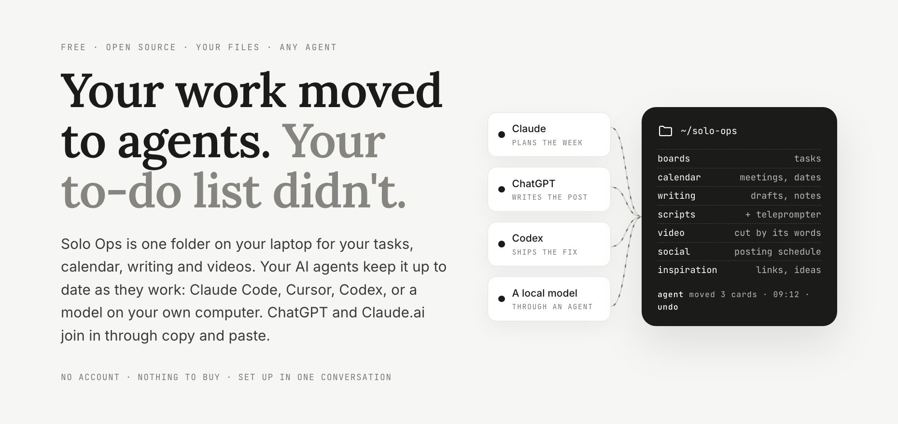
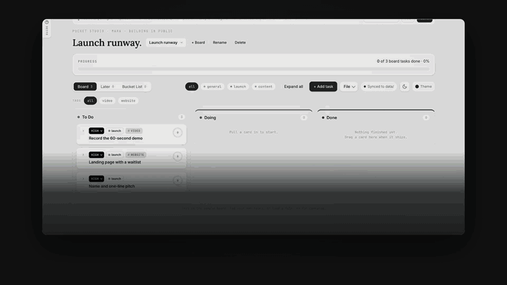
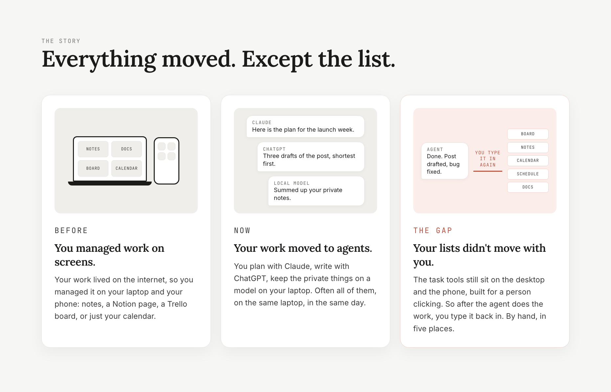
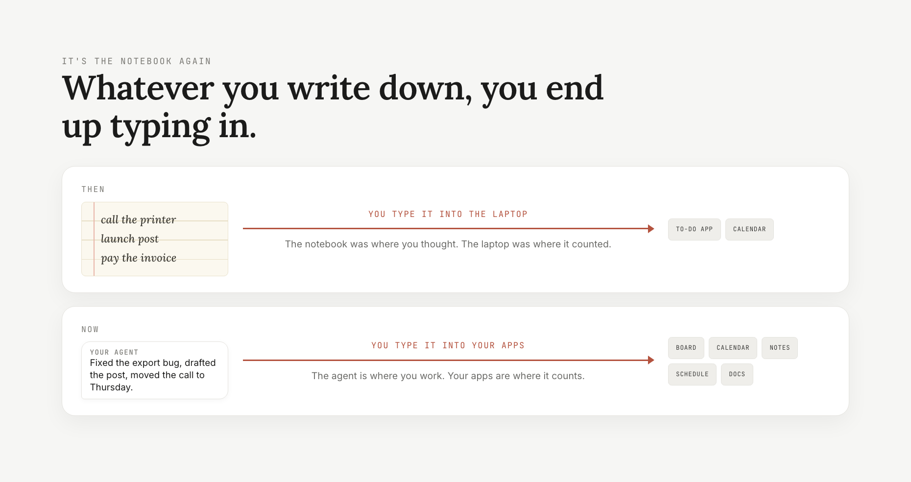
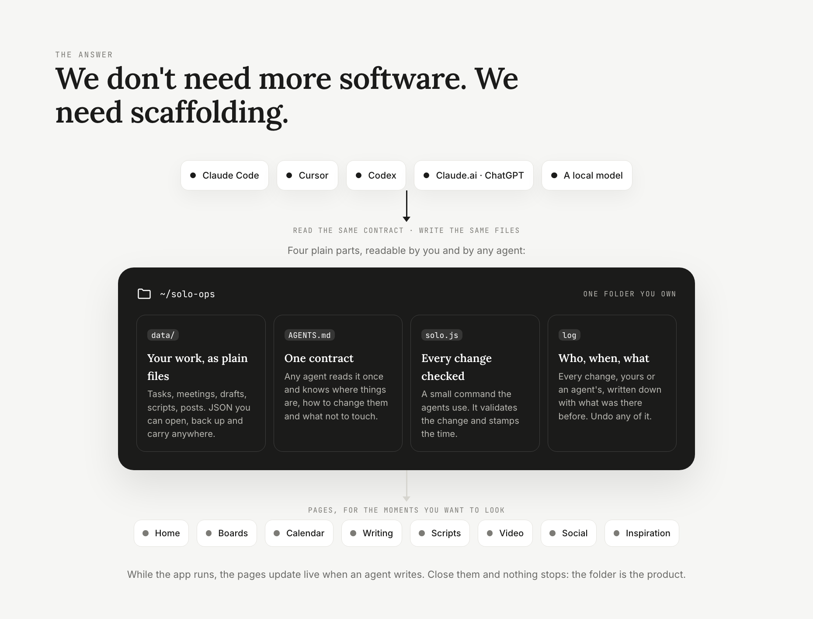
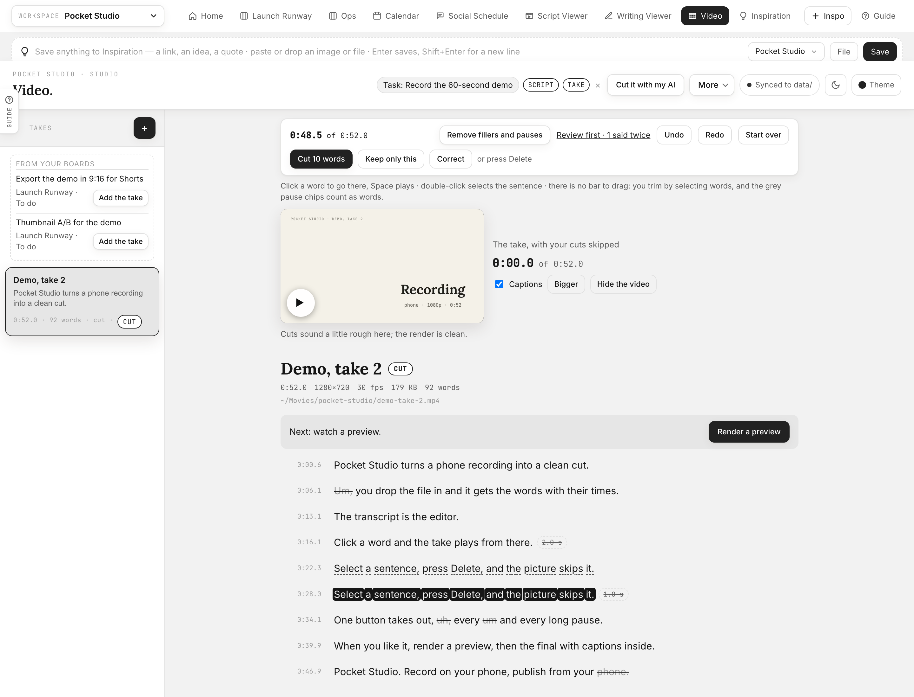

<div align="center">



# Solo Ops

**One folder for your work. Every AI agent can run it.**

Your tasks, calendar, writing and videos in one folder on your laptop. Your
AI agents keep it up to date as they work: Claude Code, Cursor, Codex, or a
model on your own computer; ChatGPT and Claude.ai join in through copy and
paste. Free, open source, no account. Set up in one conversation.

[](LICENSE)


[Website](https://anshulixyz.github.io/solo-ops/) ·
[The story](#your-work-moved-to-agents-your-lists-didnt) ·
[What's inside](#whats-inside) ·
[Get started](#get-started-in-one-conversation) ·
[AGENTS.md](AGENTS.md) ·
[What's coming](#what-is-coming) ·
[Contributing](CONTRIBUTING.md)



<sub>One week of Mara's one-person studio in a minute: on Monday her folder is empty, by Friday her agents have filled and kept it current.</sub>

</div>

> [!IMPORTANT]
> **Two promises.**
> 1. **Your work stays yours.** It lives in `data/` on your computer as plain files. It never enters this code repository (a guard refuses the commit), and the backup goes to a *private* repo or a folder you choose. Solo Ops has no AI inside and never calls one on its own.
> 2. **Nothing silent, nothing final.** Every change, yours or an agent's, is logged with who, when and what was there before. Undo any of it with one command, or from Home while the app runs.

<details>
<summary><b>Table of contents</b></summary>

- [Your work moved to agents. Your lists didn't.](#your-work-moved-to-agents-your-lists-didnt)
- [Get started in one conversation](#get-started-in-one-conversation)
- [What you can ask it](#what-you-can-ask-it) · [your own workflows](#your-own-workflows)
- [What's inside](#whats-inside)
- [Works with your agent, any agent](#works-with-your-agent-any-agent)
- [It shapes itself to you](#it-shapes-itself-to-you)
- [The structure is the product](#the-structure-is-the-product)
- [Keeping it safe](#keeping-it-safe)
- [The bigger idea](#the-bigger-idea)
- [What is coming](#what-is-coming)
- [Reference: video, the task card, the terminal, settings, sync](#reference)
- [Repo layout and development](#repo-layout-and-development)

</details>

## Your work moved to agents. Your lists didn't.



Your work lived on the internet, so you managed it on your laptop and your
phone. Then your work moved to agents: you plan with Claude, write with
ChatGPT, keep the private things on a model on your laptop, often all in the
same day. **Your lists did not move with you.** So after the agent does the
work, you type it back in. By hand, in five places.



So the question was simple: **why can't all your agents work in the same
folder, and keep your work up to date for you?**



The new interface is the agent. What it needs is not more software but
**scaffolding**: a structure in its own language. Where your work lives,
what shape it has, what changed and who changed it, how to undo it. Solo
Ops is that structure, as one folder on your computer. Whatever you do with
your agents, or outside them, all of them can track it and manage it for you.

**You decide who does what: you, an agent, or a mix. Your agents do the
managing.**

## Get started in one conversation

```bash
git clone https://github.com/anshulixyz/solo-ops && cd solo-ops
```

Open the folder in Claude Code, Cursor or Codex and type **`/setup`** (or
say "read AGENTS.md and set Solo Ops up for me"). It asks three questions in
one message: you and your project, where your tasks live today, where the
private backup goes. Then it does the rest: an empty project with your name
on it, the page open, **your open work brought in** from Notion, Linear,
Todoist, Trello or a list, and the backup. `/menu` any time for everything
you can ask.

Needs Node 18 or newer. Nothing else to install, no npm packages.

<details>
<summary><b>No agent in a terminal? Two other ways in</b></summary>

**Just open it.** Download or clone, double-click `index.html`. It starts
empty: Home offers **Bring in my work** (with your AI), **Add tasks**, or
**Look around a sample project** (a separate project you can remove).
Everything works from `file://`. In Chrome or Edge, click **Link folder**
once and the pages write `data/*.json` directly; elsewhere use **File → Save
/ Load**.

**As an app (recommended).** `node serve.js`, open http://localhost:4321 and
click **Install** in the nav. Chrome and Edge put it in your Applications
folder with its own window and Dock icon; Safari 17+ uses File → Add to
Dock. The server always serves the latest files; a service worker keeps a
copy only as the offline fallback, and `data/*.json` is never cached.

</details>

## What you can ask it

Say it in plain words, or type the command. Who does each task is your call;
the managing around it is the agent's job.

| You say | Command |
|---|---|
| "Make me boards from what I have been working on." | `/plan-project` |
| "Bring in my tasks from Notion, Linear or Todoist." Re-runs update, never duplicate. | `/bring-in` |
| "Put this week's meetings on my calendar." Through the calendar your agent already reads. | `/fill-calendar` |
| "What should I work on right now?" | `/now` · `/start-day` |
| "Take my daily status." | `/standup` · `/wrap` |
| "Turn this conversation into tasks." | `/capture` |
| "Write a script from this idea, then cut my take." | `/script` · `/cut-take` |
| "Draft next week's posts." | `/draft-posts` |
| "Plan the week." / "Review my week." | `/plan-week` · `/week` |

There are 39 in all, grouped by moment of the day: `node solo.js menu`, or
the Guide (`?` on the left edge of every page). Every Guide prompt is also a
slash command; the catalogue is [docs/guide-prompts.md](docs/guide-prompts.md).

### Your own workflows

If your agent is connected to Gmail, your calendar, Notion, Linear or other
apps, you can make your own workflows: describe one once in plain words and
your agent fills a board in Solo Ops every time you ask, or every morning.

> "Every morning, read my inbox. Every email I need to reply to becomes a
> task on the **Replies** board, due tomorrow. Skip newsletters."

The same works for this week's meetings (`/fill-calendar`), work assigned to
you in other tools (`/bring-in`) and the action items after a call
(`/capture`). There is no mail or calendar code inside Solo Ops and no login
to give it: the connector lives in your agent, and Solo Ops gives it a place
to put the result, a log of every change and an undo. Run a workflow with
`/start-day`, or ask your agent to schedule it.

## What's inside

For anyone who keeps a to-do list. Built first for solo builders and
founders: one person who is the maker, the marketer and the manager at once.

| Part | What it does |
|---|---|
| **Boards** | Kanban style: To do, Doing, Done, Later, Ideas. As many boards as you want, one per project or area of life. Tasks carry steps, priority, tags, a time and a deadline. |
| **Calendar** | Your to-dos with a time, your deadlines, your meetings, your posts. Work and personal in one view: the school form due Friday sits next to the launch. |
| **Writing** | Drafts and notes, with marks your agent understands: `~~cut this~~`, `++add this++`, `[[a note to the agent]]`. |
| **Scripts** | Short video scripts (hook, numbered beats, inserts, prep) and a built-in teleprompter to read them from. |
| **Video** | Edit a take by its transcript: delete the words, the video follows. The footage never moves and never uploads. |
| **Social** | A posting schedule: copy, prep, posted, stats, and a streak. |
| **Inspiration** | An inbox for links, ideas and images you want to keep, with a capture strip on every page. |
| **Home** | Today across every project: the next meeting, what is in Doing, overdue and this week, a quick add that understands "Call Sam tomorrow 14:00", Share today as an image. |
| **The Guide** | The panel beside every page: what to ask, copy for your AI, paste the reply back, backup and settings. |

<p align="center"></p>

<table><tr>
<td></td>
<td></td>
</tr><tr>
<td></td>
<td></td>
</tr><tr>
<td></td>
<td></td>
</tr><tr>
<td></td>
<td></td>
</tr></table>

Every page has a **⌘K command palette** with the same verbs as the CLI, a
**theme picker** (auto, light, dark, five palettes, four fonts) and a **sync
pill** that tells you where your data is.

## Works with your agent, any agent

| | How it works |
|---|---|
| **An agent in the folder**<br><sub>Claude Code · Cursor · Codex</sub> | It reads `AGENTS.md` (and `CLAUDE.md`), the contract: where the files are, their shape, the commands, what not to touch. Every Guide prompt is a slash command (`.claude/commands`, `.cursor/commands`; `node solo.js prompts export --for codex` writes them to `~/.codex/prompts`). The agent runs `node solo.js` and the pages follow live. |
| **A chat**<br><sub>Claude.ai · ChatGPT</sub> | Open the Guide, say what you want, **Copy for your AI**. The copy carries the task, board or schedule you picked and the reply format, so a fresh chat needs no setup. Paste the whole answer into **Reply**: every change is previewed and applied only when you say so. |
| **Just you** | Open the pages. The Guide's **Quick** tab and ▶ Start / ✓ Done on Home do the daily moves with no AI at all. |

A model on your own laptop works too, when it runs through an agent that can
open the folder and run commands. Your tasks in Notion, Linear, Todoist,
Trello or GitHub, and the meetings on your calendar, come in through the
connectors your agent already has: **the agent is the integration**, so
there is no OAuth inside Solo Ops.

## It shapes itself to you

Everyone manages work differently. A Notion person, a Trello person, a notes
person, a calendar person. Solo Ops asks and sets itself up that way: only
the parts you use are on (`config set apps.social false`), boards named the
way you think, your own prompts next to the built-in ones (they land in
`.claude/commands/mine/`, never in the repo). Your agent reads the contract
in the folder, learns your pattern and keeps to it. Your other work can come
in too, so it is one space from day one.

## The structure is the product

Your agent can already do all of these things. Doing them with agents takes
a lot of structure, and that structure is what software subscriptions charge
for, even the ones that call themselves agent-first. Solo Ops gives you the
structure without the burden.

| What running work with agents takes | Rented | **Solo Ops** |
|---|---|---|
| Where your work lives | Their server, behind a login | **A folder on your computer** (`data/*.json`) |
| The shape of it | Their database, their export | **Plain JSON and one schema file** ([data/SCHEMA.md](data/SCHEMA.md)) |
| How an agent gets in | An API key, scopes, a connector per app | **It opens the folder and reads [AGENTS.md](AGENTS.md)** |
| What changed, and who | Their activity feed | **Every change logged** with who and when (`node solo.js log`) |
| Undo | Whatever their undo covers | **Any change**: `node solo.js revert <id>`, or Home while the app runs |
| Backup | Their export button | **Your own private repo** or a syncing folder, daily |
| The price | A seat, a month | **Free, MIT** |

## Keeping it safe

- **Every write is logged** with its previous content; `node solo.js revert
  <id>` undoes it (or Home → Recent changes, while `node serve.js` runs). Agents sign as `agent` with a
  note saying why. Replies pasted into the Guide never delete anything.
- **Your content never enters this repo.** This folder is the Solo Ops code,
  and the code is public, including any copy of it. `data/` is git-ignored
  except the schema, and `node solo.js guard` (a pre-commit hook after
  `guard --install`) refuses any commit that stages tasks, posts, exports,
  attachments or personal prompts. If you keep a *private* fork and want
  one repo for both, `guard --allow-data` checks the remote is private and
  then steps aside.
- **Backup is part of setup.** `node solo.js backup setup` creates a
  **private** GitHub repo (`solo-ops-data`) and pushes `data/` there, or
  `backup --to "<a folder that syncs>"` for iCloud Drive or Dropbox.
  `backup --daily` schedules it. Public repositories are refused. Until it
  is done the Guide shows a reminder on every tab.
- **`node solo.js doctor`** validates every data file, finds missing or
  unused attachments, and warns when the last backup is older than a week.
- **Exports stay with your data** in `data/exports/`, including the safety
  copy taken before any destructive action.

## The bigger idea

**Software lived on servers because building it was hard.** So we rented
it: someone else's server, someone else's database, a login, a seat, a
monthly price.

Agents flipped both sides. Building and keeping small software became easy.
And software on servers became hard for agents to use: logins, dashboards,
rate limits, an API for every vendor, your own data behind someone else's
screen. The operator of software changed, from a person at a screen to an
agent working for a person. Solo Ops is built for the new operator, and
simplifies to what agents can do today:

| Instead of | Solo Ops |
|---|---|
| A hosted database | **The database is a folder**: plain JSON you own |
| A REST API per vendor | **The API is a command**: `node solo.js add · done · move` validates every change |
| An integration marketplace | **The integration is a text file**: `AGENTS.md`, read by any agent |
| An audit log on the top plan | **Trust is a log**: who, when, what, undo |
| The app is the product | **The pages are optional**: for the moments a person wants to look |

Sharing between people is coming next, built the same way: nothing reaches
you without your yes.

## What is coming

**Today Solo Ops is for heavy AI users**: people who work with agents every
day and are fine running a simple command, or letting their agent run it.
If this project takes off, the plan is to make this scaffolding easy for
anyone who keeps a to-do list. Designed, not shipped; the working list is
[NEXT.md](NEXT.md).

- **WhatsApp and Telegram.** Add a task, tick one off or ask what's next
  from the chat you already have open; send a link and it lands in your
  inbox.
- **Send tasks to others.** Hand a task to a teammate, an editor or a
  cofounder; their agent puts it on their board, the way they keep it.
  Status and ticked steps come back the same way.
- **Receive tasks through your agent.** Requests from other people arrive
  at your agent, and nothing lands on your board without your yes. Nobody
  types a status update.
- **On your phone.** The pages installed as an app on your phone (a PWA),
  served from your laptop over your own wifi. No cloud in between.
- **From any app, no pasting.** A local MCP server, so Claude Desktop,
  ChatGPT or Cursor read and update the folder directly.
- **Easy for everyone.** A setup with no commands, for people who don't use
  a terminal. The structure stays the same: your files, any agent, every
  change undoable.

## Reference

<details>
<summary><b>Video: cut a take by its words</b></summary>

The promise: **the footage never moves, only its words do.** Solo Ops cuts
the file on your disk, at its quality, by its transcript.

1. **Record, or add a take.** Save a recording into the recordings folder
   (`node solo.js video recordings` prints it) and it shows up on the Video
   page while the server runs. Or drop it on the page, or paste its path.
   Nothing is copied. `/setup-video` has your agent install ffmpeg, the
   words engine, the folder and the recorder in one conversation.
2. **Get the words.** Three ways, you pick, never a paid one on its own: on
   this computer (whisper.cpp, free, nothing leaves the machine),
   ElevenLabs (only the audio is sent, the price is shown first, the key
   stays in `data/secrets.json`), or a transcript you already have (SRT,
   VTT, JSON).
3. **Cut.** The transcript is the editor: select words and press Delete;
   select a struck word to put it back. **Remove fillers and pauses** in
   one click, **Keep only this** to trim, C to fix a misheard word (the
   audio does not change). Or *Cut it with my AI*: your agent proposes the
   cut in plain words and waits for your yes.
4. **Render.** A 720p preview first, the full-quality final after you
   watched it. Captions ride along as a track and a `.srt`. Renders are
   numbered, never overwritten.
5. **Post.** *Make the post* puts a draft on the schedule with the final
   linked, never copied.

Needs ffmpeg (`brew install ffmpeg`, `winget install Gyan.FFmpeg`) and, for
the buttons, `node serve.js`. Renders live in `data/videos/<take>/` and never
enter the backup; the words and the `.srt` do.

</details>

<details>
<summary><b>A task carries its pieces</b></summary>

The board card is the one unit. Tag a task `writing`, `script` or `video`
and it carries four pills, **Draft · Script · Take · Post**, plus one button
for the next step (*Write the draft*, *Start the script*, *Add the take*,
*Make the post*). The piece is made for that task and attached to it;
**attach** takes one that already exists. In the Writing, Script and Video
views the open item shows **Task: …** or **Connect with a task…**. Agents do
the same with `node solo.js link <task> <piece>`, `story <task>` and
`--task` on the add commands.

</details>

<details>
<summary><b>The terminal</b></summary>

```bash
node solo.js today                          # in play now + idle reminder
node solo.js week --days 14                 # a longer window; --ws <id> picks a project
node solo.js add "Write the launch post" --proj launch --pri high --tags content --steps "Outline|Draft"
node solo.js add "Call with Sam" --at tomorrow 14:00 --until 14:30 --tags meeting
node solo.js start "Write the launch post" ; done t5 ; move t11 later ; check t5 2
node solo.js calendar --days 14             # the agenda
node solo.js social add "Launch day" --at +3d 9:00 --type launch ; social next ; social posted p4 --url …
node solo.js scripts add "Teaser" --file teaser.md ; notes list
node solo.js video add "Take 3" --file ~/Movies/take-3.mov ; video transcribe <take> ; video cut <take> --tidy ; video render <take> --preview
node solo.js link <task> <script> ; story <task>
node solo.js inspo add "https://… worth stealing #launch" ; inspo use "worth stealing" --as task
node solo.js import list.md                 # "- [ ] item" lines → tasks
node solo.js share today                    # today as a short card
node solo.js menu                           # what you can ask your agent (= /menu)
node solo.js log ; node solo.js revert <id>
node solo.js help
```

`--json` on anything for machine output. `--ws <id>` and `--board <id>`
scope any command.

</details>

<details>
<summary><b>Make it yours</b></summary>

`solo.config.js` is part of the app, identical for everyone, so your own
settings (your name, project, board titles, post types) live next to your
tasks in `data/settings.json`:

```bash
node solo.js config set owner "Mara" name "Pocket Studio"
node solo.js config add social.postTypes reel carousel
node solo.js config set boards.runway.title "Launch runway"
node solo.js config                          # what is in use
```

Any key of `solo.config.js` works. The Theme button offers light and dark,
five palettes and four font presets; `?theme=dark&palette=dusk&font=system`
works on any page. A first open starts blank; the sample sprint is a
separate **Sample project** (`node solo.js template sample`) that never
mixes into your work.

</details>

<details>
<summary><b>How sync works</b></summary>

The browser keeps a working copy in `localStorage`; `data/*.json` is the
source of truth agents and the CLI see. Each file carries `updatedAt`; the
newer side wins. Served and linked-folder modes write on every change and
poll for outside edits every few seconds. On first contact a blank first
open yields to the file, registries merge, and real content on both sides
asks you; the losing side is downloaded as a backup either way. Details:
[data/SCHEMA.md](data/SCHEMA.md), `core/sync.js`.

</details>

## Repo layout and development

```
index.html            Home (all projects)        about.html  the longer story
solo.config.js        the shipped defaults (yours: data/settings.json via config set)
solo.js               CLI (node, zero deps)      serve.js    local server + write API + change log
AGENTS.md             the contract every agent reads (CLAUDE.md points to it)
core/                 store · config · theme · sync · activity · palette · templates · prompts
runway/ calendar/ social/ studio/ inspo/   the apps (classic scripts, file:// safe)
data/                 your content, git-ignored except SCHEMA.md
.claude/commands/ .cursor/commands/        the Guide prompts as slash commands (generated)
docs/                 guide.md, guide-prompts.md, the website (index.html), images
```

Static HTML, CSS and classic `<script src>`: no build step, no npm
dependencies, no ES modules, openable from `file://`. `npm test` runs the
syntax check of every script and the test suites. Start with
[NEXT.md](NEXT.md); [AGENTS.md](AGENTS.md) is also the contributor guide,
and [CONTRIBUTING.md](CONTRIBUTING.md) has the rest.

---

<div align="center">

**One folder. Every agent.** You decide who does what. Your agents do the managing.

MIT License · [LICENSE](LICENSE) · [Contributing](CONTRIBUTING.md) · [Security](SECURITY.md)

</div>
