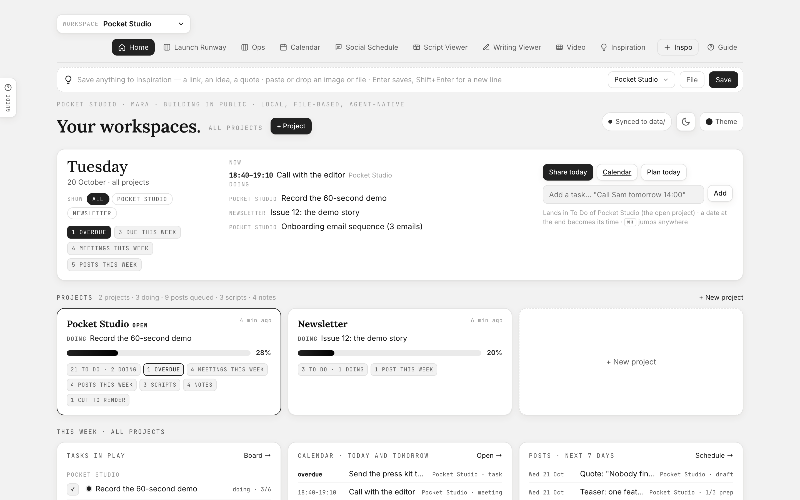
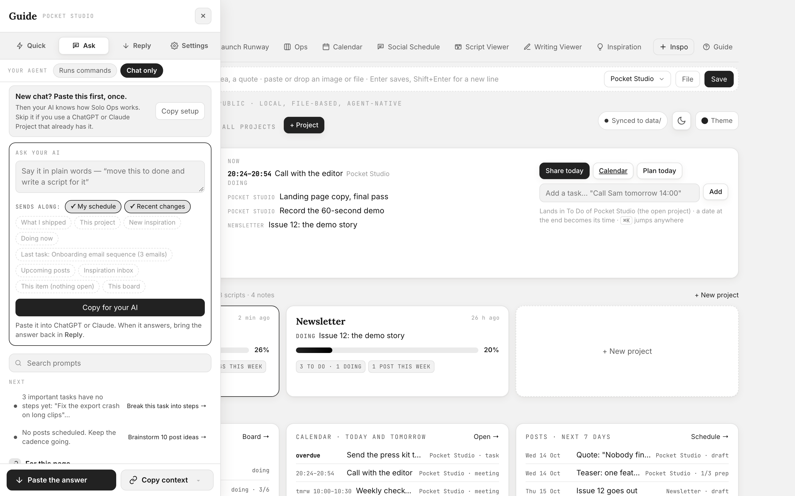
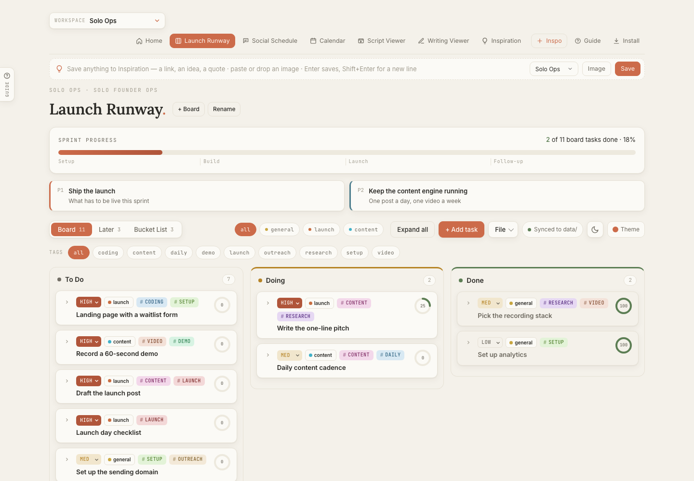
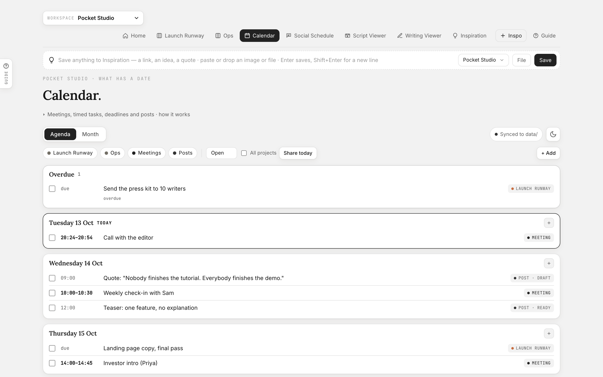
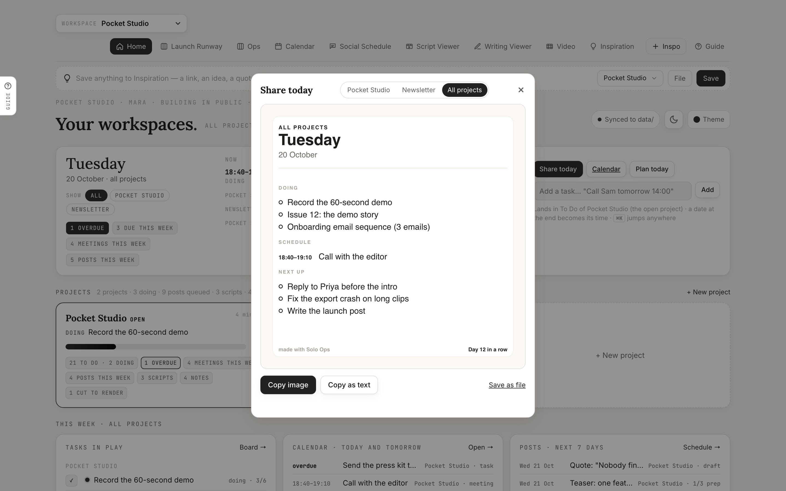
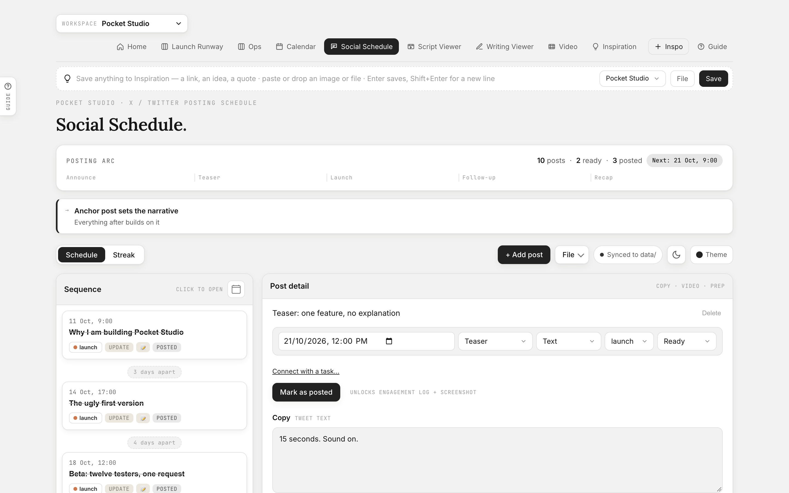
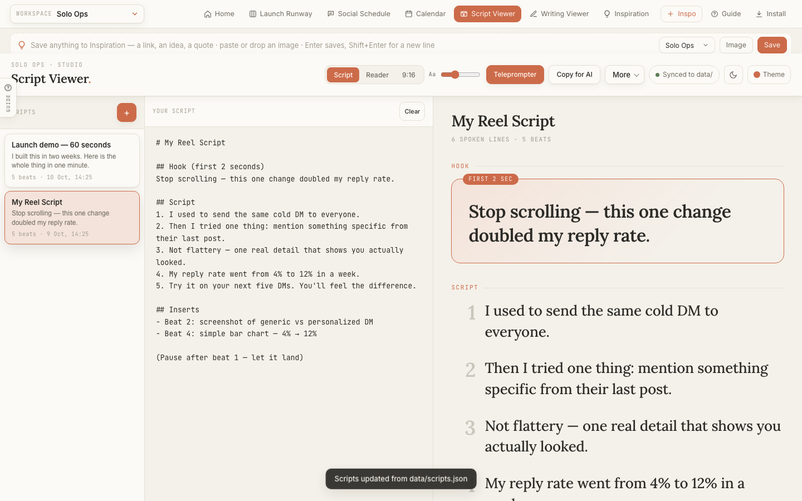
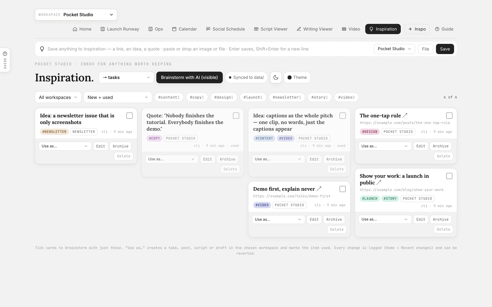

<p align="center"></p>

<h1 align="center">Solo Ops</h1>
<p align="center"><b>Your tasks, meetings, posts and drafts in one folder on your own computer, managed for you by the AI you already use.</b><br>
Boards · calendar · posting schedule · video scripts · drafts · inspiration inbox — local, installable, works with any AI.</p>

---

**Every tool lets you give a task to an AI. None of them lets the AI manage
your tasks.** Managing still means a project tool, ten plugins and
connectors, and typing every task in by hand after the AI did the work.

Solo Ops flips it. You decide who does what: you, an agent, a human, a mix.
Your AI does the managing: it plans the project, adds the tasks, moves the
cards, fills the calendar, writes the standup. You work inside the AI you
already use (ChatGPT, Claude, Claude Code, Cursor) and never type a task
twice. Everything stays local: one folder on your computer, plain files,
no account. Solo Ops never calls an AI for you.

<p align="center"></p>

<table><tr>
<td></td>
<td></td>
</tr><tr>
<td></td>
<td></td>
</tr><tr>
<td></td>
<td></td>
</tr><tr>
<td colspan="2"></td>
</tr></table>

```
$ node solo.js week
# Next 7 days · Oct 10 → Oct 17
Last activity 2 h ago · streak 6 days
**Launch:** 4/11 done (36%)   **Business as usual:** 2/5 done
## Doing (2)
- [t3] Record a 60-second demo · content · high · 1/4 steps
…
```
…and the board in your browser updates by itself.

## Who it is for

- **The solo founder** ships a product, answers support, chases invoices and
  has a life. One board holds all four; the agent that writes the code also
  drafts the replies and keeps the board honest.
- **The creator** has a pipeline of videos and letters, sponsors to close, an
  editor to pay. Scripts, a posting arc and the week's deadlines in one place.
- **The freelancer** keeps clients, money and errands on the same board,
  because that is what a week is.

## Three ways in

| | |
|---|---|
| **Just you** | Open the pages. Boards, calendar, schedule, scripts, drafts, inbox. The Guide's **Quick** tab and the ▶ / ✓ on Home do the daily moves with no AI at all. |
| **A chat** (ChatGPT, Claude.ai) | Open the Guide, type what you want in plain words — *"move this to done and write a script for it"* — and **Copy for your AI**. The copy carries the task, board or schedule you picked and the reply format. Paste the answer back; every change is previewed before it lands. |
| **An agent that runs commands** (Claude Code, Cursor, Codex) | `/standup`, `/plan-project`, `/fill-calendar` and every other Guide prompt is a slash command; the agent runs `node solo.js` and the pages follow live. |

## Why it exists

It started as one person's problem: a creator, a developer and a founder at
once, needing one more SaaS every month, none of which let the AI in. Plain
files on your own computer are enough, and the AI you already pay for can do
the managing. The longer story and what is coming next:
[`about.html`](about.html) (also linked from Home and the Guide).

## Why it is different

| | Solo Ops |
|---|---|
| **Where your data lives** | `data/*.json` in a folder you own. No account, no server, no sync service. |
| **How your AI uses it** | It reads the same files. A coding agent gets `AGENTS.md`; a chat gets the context and the reply format inside every prompt. Every agent change is logged and revertable. Solo Ops never calls a model itself. |
| **How you use it without clicking** | `node solo.js today / week / add / done / social next / inspo add …` |
| **How many projects** | As many **projects** as you like (a workspace in the files and CLI), each with its own boards, schedule, scripts and notes — and a Home that shows all of them at once, or one at a time. |

## The apps

| | What it does |
|---|---|
| **Home** | *Your name's workspaces* (`node solo.js config set owner "Mara"`; `/setup` asks for it). A Today strip: the meeting in progress or the next one, what is in Doing, overdue and this-week counts, **Show** chips that filter the page to all projects or one, a quick add that understands "Call Sam tomorrow 14:00", **Share today** as an image or text for any project or all, Plan today with your agent. One card per project that opens its Overview (boards, apps, rename / remove). **Tasks in play** for the week with ▶ Start and ✓ Done on every row, whichever project it belongs to; calendar today and tomorrow; posts for the week; the inspiration inbox; recent changes in plain words with *Restore a file* underneath; the activity streak folded away. |
| **Boards** | Kanban: To Do / Doing / Done, a Later parking lot, a Bucket List for ideas. Checklists, priority, project chips, tags, notes, drag & drop. One file per board; create boards blank, from the sample sprint, or as a copy. |
| **Calendar** | Everything with a date in one place: tasks with a time or a deadline, **meetings** (a task with a time and the tag `meeting`), and posts, across every board, with *all projects* a click away. Agenda (today onward, overdue first) and Month. Filter by board, meetings, posts; tick to finish; click to open the item where it lives; + on any day. Your agent fills it: Guide → **Bring in** → *Fill my calendar* reads the calendar your Claude or ChatGPT is connected to and adds the week's meetings (re-runs update, never duplicate). `node solo.js calendar` prints the same agenda; `add --at tomorrow 14:00 --until 14:30 --tags meeting` adds one. No calendar OAuth inside Solo Ops: the agent is the integration. |
| **Social Schedule** | A posting arc: date, copy, type, prep checklist, images, video status; mark posted and log engagement. Calendar with a 52-week streak heatmap. |
| **Script Viewer** | Reels/shorts scripts: hook, numbered beats, inserts, prep. Reader view, 9:16 preview, teleprompter. A library of scripts. |
| **Writing Viewer** | Drafts with `~~cuts~~`, `++adds++` and `[[notes for the AI]]`. Copy for AI, copy clean, change log view, images. |
| **Video** | Cut your takes by their words. The footage stays where it is: add a recording by path, get its words with their times (on this computer with whisper.cpp, through ElevenLabs with only the audio leaving, or from an SRT you have), click a sentence to cut it, drop the fillers in one go, render a 720p preview and the full-quality final with captions, link it into a post. Every edge lands on a word, every cut is logged and revertable. See [Video](#video). |
| **Inspiration** | An inbox for anything worth keeping. A **capture strip sits under the nav on every page**: type or paste anything and press Enter; drag a link, text or image from anywhere toward the page and drop it; paste with nothing focused. Images save the moment they arrive, details are optional. Every item gets basic information for free: a kind tag, the site as a tag for links, and (with the server running) the page's real title and description. Each save shows a toast with Undo. **Assess new inspiration** hands your agent only what you saved since last time. Tag with a workspace, then **Use as** task / post / script / draft, or **Brainstorm with AI** (copies the items plus instructions for your chat). |
| **Guide** | The panel on the left edge of every page (`?`). **Quick**: daily moves with no AI. **Ask** starts with **Ask your AI**: say it in plain words, tick what goes along (this task, this board, my schedule, recent changes), **Copy for your AI**; the ritual prompts (standup, plan the week, cut scope, fill my calendar…) sit under it. **Reply**: paste the whole answer, preview every change, apply. **Settings**: runs commands or chat only, backup, export / import. Every prompt is also a slash command. |

Every page has a **⌘K command palette** with the same verbs as the CLI, a
**theme picker** (auto/light/dark × five palettes) and a **sync pill** that
tells you where your data is.

## Install

**Handing it to your agent?** Clone, open the folder in Claude Code, Cursor
or Codex, type `/setup` (or say "read AGENTS.md and set Solo Ops up for
me"). It asks four questions (your name, what you are building, which
parts, sample or empty) and does the rest, backup included.

**Just open it.** Download or clone, double-click `index.html`. Everything
works from `file://`. In Chrome/Edge, click **Link folder** once and the pages
write `data/*.json` directly; elsewhere use **File → Save / Load**.

**As an app (recommended).**

```bash
git clone https://github.com/anshulixyz/solo-ops && cd solo-ops
node serve.js          # http://localhost:4321
```

Open it, click **Install** in the nav. Chrome and Edge put it in your
Applications folder (under "Chrome Apps" on macOS) and it opens in its own
window with a Dock icon; Safari 17+ uses File → Add to Dock. Zero
dependencies; Node (18 or newer) is only for the server and the CLI.

**Always fresh, works offline.** Code and pages are fetched network-first, so
a running server always serves the latest files; the service worker keeps a
copy only as the offline fallback. `data/*.json` and the API are never
cached. `serve.js` stamps the worker with a hash of every file's modification
time, so each code change is a new version: open pages get a small
"New version ready — Reload" toast, and nothing reloads under you.

## The terminal

```bash
node solo.js today                          # in play now + idle reminder
node solo.js week --days 14                 # a longer window; --ws <id> picks a project
node solo.js add "Write the launch post" --proj launch --pri high --tags content --steps "Outline|Draft"
node solo.js start "Write the launch post" ; done t5 ; move t11 later ; check t5 2
node solo.js social add "Launch day" --at +3d 9:00 --type launch ; social next ; social posted p4 --url …
node solo.js scripts add "Teaser" --file teaser.md ; notes list
node solo.js video add "Take 3" --file ~/Movies/take-3.mov ; video transcribe <take> ; video cut <take> --tidy ; video word <take> "on shoe lee" "Anshuli" ; video render <take> --preview
node solo.js inspo add "https://… worth stealing #launch"
node solo.js inspo use "worth stealing" --as task
node solo.js boards add "Business as usual" --from sample
node solo.js workspaces add "Side project" --apps scripts,writing --sample
node solo.js share todo                     # markdown checklist, paste anywhere (| pbcopy on a Mac, | clip on Windows)
node solo.js import list.md                 # "- [ ] item" lines → tasks
node solo.js log ; node solo.js revert <id>
node solo.js help
```

`--json` on anything for machine output. `--ws <id>` and `--board <id>` scope
any command.

## Video

The promise: **the footage never moves, only its words do.** Descript makes
you upload a take and cuts a lowered-quality proxy; Solo Ops cuts the file
on your disk, at its quality, by its transcript.

1. **Record, or add a take.** Record with any app (Recordly, QuickTime, your
   phone) and save the file into the recordings folder (`~/Movies/Solo Ops
   takes`; `node solo.js video recordings` prints it): it shows up on the
   Video page by itself while the server runs. Or drop the recording on the
   page (it finds it in Movies, Desktop, Downloads or Documents) or paste
   its path. Nothing is copied. Tick *Get the words this way for every new
   take* once and new takes get their words by themselves. Terminal:
   `node solo.js video add "Title" --file ./take.mov`. *Set up video on this computer* in the Guide
   (`/setup-video`) has your agent install ffmpeg, the words engine, the
   folder and the recorder in one conversation.
2. **Get the words.** Three ways, you pick, never a paid one on its own:
   on this computer (whisper.cpp, free, nothing leaves the machine), ElevenLabs
   (the audio is sent, the video stays, the price is shown first; the key is
   pasted once into a field on the page and stays in `data/secrets.json`),
   or a transcript you already have (SRT, VTT, JSON).
3. **Cut.** The transcript is the editor and the player follows it: click a
   word, press Space, and the take plays from there with your cuts skipped; select words
   (or a sentence) and press Delete, or Cut; select a crossed-out word to
   put it back. **Remove fillers and pauses** takes um, uh, you know and
   every pause longer than 0.7 s (`video.pause`) in one click, or *Review
   first* to untick single ones and see what was said twice; Undo and Redo
   are there. A misheard word is fixed by selecting it and pressing C (the
   audio does not change). Every edge lands on a word, padded; pauses are
   measured on the audio, not guessed from the words. Or *Cut it with my
   AI*: your agent reads the words, proposes the cut in plain words, waits
   for your yes, and the cut lands on the page. iPhone footage the browser
   cannot play gets a 720p copy for the player with one click.
4. **Render.** A 720p preview first; the final at full quality after you
   watched it. Captions ride along as a track and a `.srt`. One render at a
   time; renders are numbered, never overwritten.
5. **Post.** *Make the post* puts a draft on the schedule with the final
   linked, never copied; *Post this video* in the Guide writes the copy.

Needs ffmpeg (`brew install ffmpeg` on a Mac, `winget install Gyan.FFmpeg` on
Windows) and, for the buttons, `node serve.js`. Without the server the page
still cuts (clicking saves the cut) and shows the terminal line for the rest.
Renders live in `data/videos/<take>/` and never enter the backup; the words
and the `.srt` do.

## Your AI runs it

- **Claude Code / Cursor / Codex / any coding agent:** open the folder. `AGENTS.md`
  (and `CLAUDE.md`) is the contract: files, schema, CLI, conventions, read
  automatically. Type `/standup`, `/now`, `/week`, `/stuck`, `/cut-scope`,
  `/ship-post`… — every Guide prompt is a slash command (`.claude/commands`,
  `.cursor/commands`; `node solo.js prompts export --for codex` writes them to
  `~/.codex/prompts`, where Codex looks).
  Or just ask: "what should I do this week?", "turn my inspiration into
  tasks", "draft the three posts for launch week". An agent that was *not*
  opened in the folder gets Guide → Settings → *Set up this folder*.
- **Claude.ai / ChatGPT (no file access, no terminal):** open the Guide,
  pick **Chat only**, type what you want in the **Ask your AI** box or click
  a prompt. The copy carries the context you picked and the reply format, so
  a fresh chat needs no setup. When it answers, paste the whole answer into
  **Reply**: the changes are picked out, previewed, and applied only when you
  say so. Optional: *New chat? Paste this first, once* (also
  `prompts/agent-bootstrap.md`) into a ChatGPT or Claude Project.
- **Every agent change is logged** with `source: agent` and a note. Home →
  Recent changes shows it; one click reverts it. `node solo.js log` from
  the terminal.
- **Scheduled nudges:** `node solo.js today` in cron, a Claude scheduled
  task or a Shortcut. It prints the idle reminder too.
- **Planned:** an MCP server so Claude Desktop, ChatGPT, Cursor or a phone
  client use the folder without pasting; Telegram and WhatsApp for `/add`,
  `/done`, `/next` and links from your phone. See *What is coming*.

## Keeping it safe

- **Every write is logged** with its previous content (a file's first write
  has none); `node solo.js revert <id>` or Home → Recent changes undoes it. Replies pasted into the Guide never
  delete anything (`rm` is ignored).
- **Your content never enters this repo.** `data/` is git-ignored except the
  schema, and `node solo.js guard` (installed as a pre-commit hook by
  `guard --install`) refuses any commit that stages tasks, posts, exports,
  attachments or personal prompts. The rule binds every agent working in the
  folder (`AGENTS.md`, *Privacy boundary*); the place for your content is a
  private repo via `backup`.
- **Exports stay with your data.** Export everything, a board as JSON or
  Markdown, the social bundle, and the safety copy taken before *Load
  template* or *Clear* are written to `data/exports/` when `node serve.js`
  runs or the folder is linked (so `backup` carries them too). Without
  either, the browser downloads them as before.
- **Backup is part of setup.** `node solo.js backup setup` gives your data a
  private home: with the GitHub CLI logged in it creates a **private** repo
  `solo-ops-data` and pushes `data/` there; otherwise it tells you the two
  other ways (a private repo you create and pass with `--remote`, or
  `backup --to "<a folder that syncs>"` for iCloud Drive / Dropbox, no git).
  `backup --daily` schedules it. It **refuses public repositories**. Until
  it is done the Guide shows *Save your data somewhere private* on every
  tab; Guide → Settings → *Protect your work* has the three ways and a copy
  button for each.
- **Why your data is not in this repo.** This folder is the Solo Ops code,
  and the code is public, including any fork of it. Your tasks, posts and
  drafts are yours, so they stay out of it on purpose. If you keep a
  *private* fork and want one repo for both, `node solo.js guard
  --allow-data` checks the remote is private and then steps aside.
- **`node solo.js doctor`** validates every data file (JSON, `updatedAt`,
  ids, columns), finds attachments that are referenced but missing or on
  disk but unused, flags originals that only exist in a browser, and warns
  when the last backup is older than a week.
- **Attachments:** an image you drop keeps a small thumbnail inside the item;
  the original is written to `data/attachments/` when the server runs or
  the folder is linked, and waits in the browser (IndexedDB, not the 5 MB
  localStorage) until then. Other files are copied up to
  `attachments.copyMaxMB` (25 by default); bigger ones are saved by name and
  size and you paste a path or a `file://` link instead. From the terminal:
  `node solo.js inspo add --file ./deck.pdf`.

## What is coming

Designed, not shipped, in roughly this order. The working list, with the
known issues, is [`NEXT.md`](NEXT.md); the story is in [`about.html`](about.html).

The direction is one idea: Solo Ops should be reachable from wherever you
and your agents already are, and take in whatever you already write things
down in. Nothing below adds a service in the middle.

- **An MCP server: use it anywhere, with any agent.** One local process that
  speaks the Model Context Protocol, so Claude Desktop, ChatGPT, Cursor or a
  phone app read and write the same files with the CLI's verbs. The Guide's
  prompts become tools the agent calls without you pasting anything.
- **Your notes on the Mac and on Windows flow in.** A read-only watcher for
  Apple Notes and Reminders, Sticky Notes and Notepad, and any Markdown
  folder (Obsidian, iA Writer): new lines become inbox items or tasks with a
  link back. Nothing is moved.
- **Pull from the apps you already use, through your AI.** The calendar works
  this way today. Next: mail, docs and meeting notes, analytics. The connector
  lives in your Claude or ChatGPT; every pull is a logged, revertable change.
- **Collaboration with no API in the middle:** an editor or cofounder points
  their own agent at the same private data repo, and the agents hand work
  back and forth through the files.
- **Telegram and WhatsApp** for `/add`, `/done`, `/next` and links from your phone.
- **Phone install, still local:** the pages served from your laptop on your
  own wifi, a QR code on Home, installed as an app.
- **Briefing packs and undo everywhere:** `node solo.js brief --for editor`,
  and ⌘Z in the browser for every change, yours or the agent's.
- **Home, a layout pass:** one header row, projects as rows, a project picker
  on the quick add. The small things are under *Minor* in `NEXT.md`.

## Make it yours

`solo.config.js` is part of the app itself, identical for everyone who
downloads Solo Ops, so do not put your name in it. Your own settings (your
name, the project name, board titles, your post types) live next to your
tasks in `data/settings.json`. Set them with
`node solo.js config set owner "Mara" name "Pocket Studio"`, add to a list
with `node solo.js config add social.postTypes reel carousel`, or ask your
agent (`/setup` does it; a pasted reply can carry `config set` lines too).
Any key of `solo.config.js` works, one board at a time as
`boards.runway.title "Launch runway"`; `node solo.js config` shows what is
in use. Git never sees that file, and if you change `solo.config.js` by
mistake the guard stops the commit. The file itself holds the defaults:
workspaces (or just the apps and boards of the default one), projects with
colors, tags, post types, prep kinds, milestones and focus cards,
idle-reminder hours, attachment size caps and the default theme. The Theme button offers light/dark, five palettes and
four font presets (Inter, System as in Trello, Lato as in Slack, Editorial);
`?theme=dark&palette=dusk&font=system` works on any page. Workspaces
and boards can also be created from Home or the CLI; sample content ships in
`data/` when you run `node solo.js template all` (every page also seeds it in
the browser on first open). Nothing in `data/` is tracked by git: your
content can never end up in a commit.

## How sync works

The browser keeps a working copy in `localStorage`; `data/*.json` is the
source of truth agents and the CLI see. Each file carries `updatedAt`; the
newer side wins. Served and linked-folder modes write on every change and
poll for outside edits every few seconds. On first contact sample data yields
to the file, registries merge, and real content on both sides asks you — the
losing side is downloaded as a backup either way. Details: `data/SCHEMA.md`,
`core/sync.js`.

## Layout

```
index.html              Home (all projects)
solo.config.js      your settings — plain JS, read by pages and CLI
solo.js             CLI (node, zero deps)   serve.js  local server + write API + change log
manifest.json sw.js icons/   installable app shell
core/                   store · config · theme · sync · activity · nav · palette · inspo-quick · templates · prompts (the Guide's built-ins, shared with the CLI)
data/                   per workspace: <board>.json, social, scripts, writing · plus inspiration, boards, workspaces, activity, settings, log.jsonl
runway/ social/ studio/ inspo/ calendar/   the apps (classic scripts, file:// safe)
prompts/ docs/ .claude/skills/   agent bootstrap, Telegram design, Claude Code skill
.claude/commands/ .cursor/commands/   the Guide prompts as slash commands (generated: node solo.js prompts export)
```

Keep apps `file://`-compatible: classic `<script src>`, no modules, no `fetch`
of local files. Sanity: `for f in core/*.js runway/*.js social/*.js studio/*.js inspo/*.js *.js; do node --check "$f"; done`
and `node social/test-social-save.js`, `node core/test-prompts.js` and `node core/test-apply.js`
(every verb a pasted reply can carry, against an in-memory store).

MIT licensed. Contributions welcome — the agent contract in `AGENTS.md` is
also the contributor guide.
